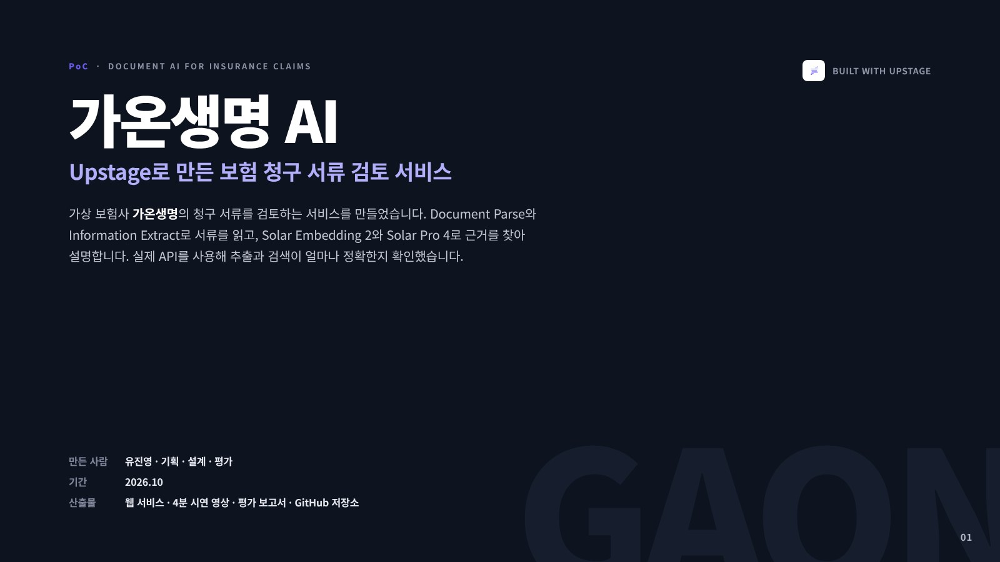
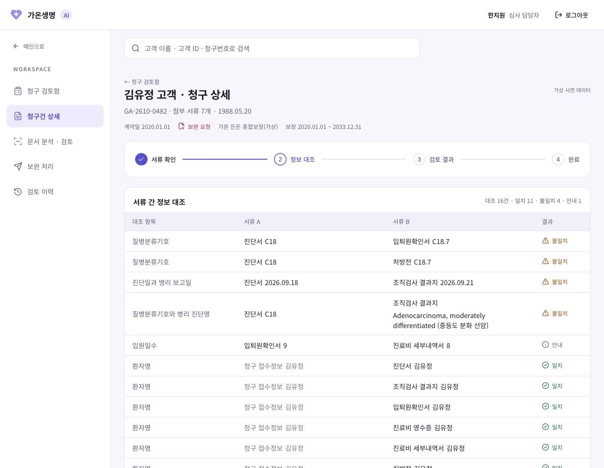
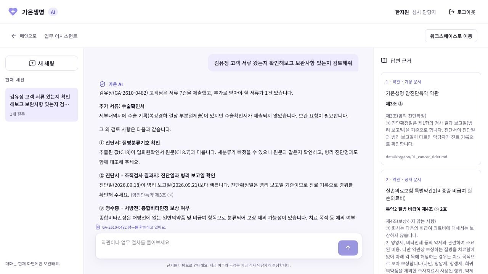
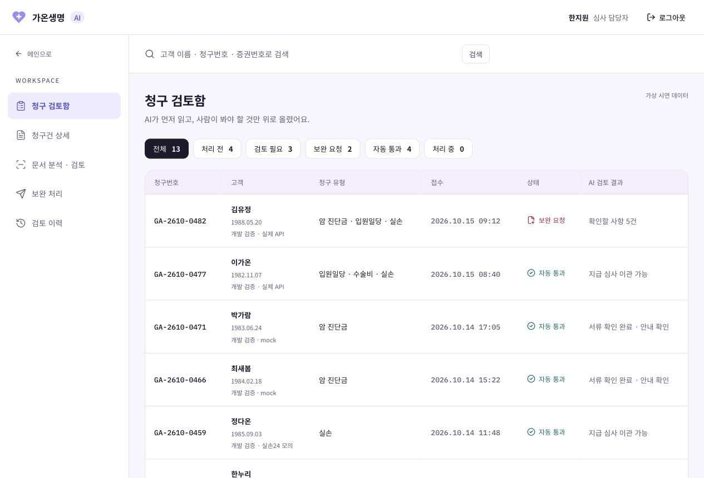
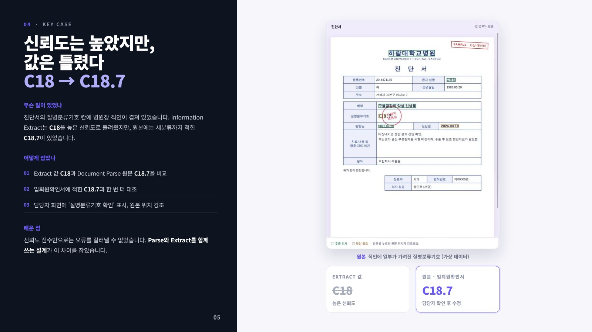
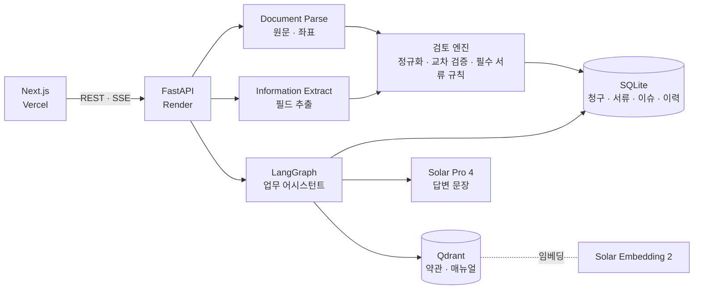
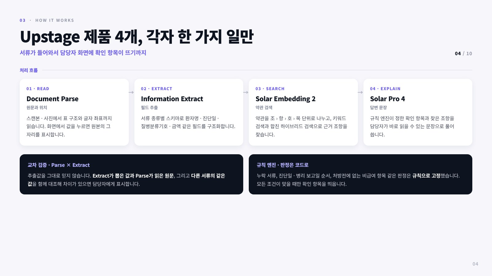
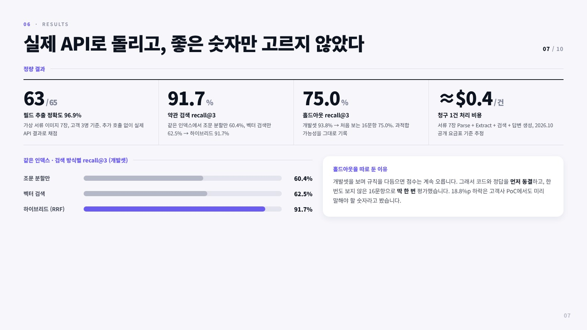

# 가온생명 AI · Upstage Document AI로 만든 보험 청구 서류 검토 PoC

<br/>

> **"보험 청구 서류를 읽고, 서로 대조하고, 담당자가 확인할 곳만 짚어 주는 AI 업무 도구입니다. 지급 여부는 판단하지 않습니다."**

<br/>



<br/>

## 목차

1. [프로젝트 소개](#1-프로젝트-소개)
2. [서비스 소개](#2-서비스-소개)
3. [핵심 설계](#3-핵심-설계)
4. [시스템 아키텍처 · 기술 스택](#4-시스템-아키텍처--기술-스택)
5. [활용 데이터](#5-활용-데이터)
6. [AI 활용](#6-ai-활용)
7. [성과](#7-성과)
8. [한계와 다음 단계](#8-한계와-다음-단계)
9. [실행 방법 · 문서](#9-실행-방법--문서)

<br/>

---

## 1. 프로젝트 소개

| 항목 | 내용 |
| --- | --- |
| **만든 사람** | 유진영 (개인 프로젝트) |
| **담당** | 문제 정의 · 시장 조사 · 요구사항 · 데이터 · 화면 설계 · 구현 · 평가 · 시연 |
| **기간** | 2026.10 |
| **기술 스택** | Python · FastAPI · LangGraph · Qdrant · Next.js · TypeScript · Docker · Render · Vercel |

- **가상의 생명보험사 가온생명**이 Upstage Document AI를 도입한다고 가정하고 만든 PoC입니다.
- 결정 기록은 [`docs/decisions.md`](docs/decisions.md), 작업 기록은 [`docs/WORKLOG.md`](docs/WORKLOG.md)에 남겼습니다.

<br/>

---

## 2. 서비스 소개

**🔗 [gaon-life-ai.vercel.app](https://gaon-life-ai.vercel.app/login)**

<sub>무료 서버를 써서 첫 접속 때 서버가 깨어나는 데 1분 정도 걸릴 수 있습니다. 모든 고객 · 서류 데이터는 가상입니다.</sub>

<br/>

### 2.1 왜 만들었나

**"청구는 앱으로 들어오지만, 검토는 여전히 사람의 눈으로 합니다."**

- 실손보험 청구 간소화(실손24)가 시행됐지만, 병원 연계율은 **47.7%**로 절반에 못 미칩니다. 나머지 청구는 여전히 사진과 스캔본으로 들어옵니다. (데일리팜, 2026.09.28)
- 자동 전송 대상은 영수증 · 세부내역서 · 처방전 같은 진료비 서류입니다. **진단서와 입퇴원확인서는 고객이 따로 찍어 올려야 합니다.**
- 암 진단 · 수술 · 입원 청구 한 건에도 서류 7건이 오갑니다. 진단일, 질병코드, 입원일수가 서류마다 맞는지 담당자가 직접 맞춰 봅니다.

<br/>

### 2.2 무엇을 하나

| 기능 | 하는 일 |
| :---: | --- |
| **청구 검토함** | 들어온 청구마다 AI 검토 상태를 붙여, 확인이 필요한 건을 먼저 볼 수 있게 합니다 |
| **문서 분석 · 검토** | 서류에서 뽑은 값을 원본 위치와 함께 보여 주고, 서류끼리 값이 다른 곳을 표시합니다 |
| **보완 처리** | 빠진 서류를 찾아 고객 안내 문자 초안을 만듭니다. 발송은 담당자가 합니다 |
| **업무 어시스턴트** | "김유정 고객 서류 확인해 줘"처럼 물으면 확인 항목을 정리하고, 약관 조항 원문을 근거로 붙입니다 |
| **검토 이력** | 누가 언제 무엇을 확인 · 수정했는지 남깁니다 |

<br/>

### 2.3 시연 영상

<!-- GitHub 웹 편집 화면에서 가온생명AI_시연_최종.mp4 를 이 줄 자리에 끌어다 놓으면 재생 플레이어가 생깁니다. -->
시연 영상 (4분 13초) 자리

<br/>

### 2.4 서비스 화면

| | |
| :---: | :---: |
|  |  |
| **서류 간 정보 대조** | **근거를 붙여 답하는 업무 어시스턴트** |

<details>
<summary><b>청구 검토함 화면 보기</b></summary>

<br/>



</details>

<br/>

---

## 3. 핵심 설계

### 3.1 AI는 짚고, 판단은 사람이

**"보험금 지급은 책임이 따르는 결정이라, AI의 역할부터 선을 그었습니다."**

| AI가 하는 일 | AI가 하지 않는 일 |
| --- | --- |
| 스캔본 · 사진에서 원문 텍스트와 위치 읽기 | 지급 여부와 지급 금액 판단 |
| 서류 간 진단일 · 질병코드 · 입원일수 대조 | 확인 필요 항목의 최종 판정 |
| 빠진 서류를 찾아 보완 요청 초안 작성 | 고객 연락 자동 발송 |
| 약관의 조 · 항 · 호를 찾아 근거로 제시 | 개인정보 외부 전달 |

- **판정은 규칙 엔진이, 읽기와 설명은 AI가** 맡습니다. 같은 서류를 넣으면 같은 확인 항목이 나오도록 판정 로직은 코드로 고정하고, LLM은 문장만 씁니다.

<br/>

### 3.2 신뢰도는 높았지만, 값은 틀렸다: C18 → C18.7



- 진단서의 질병분류기호 칸에 병원장 직인이 겹쳐 있었습니다. Information Extract는 **C18**을 높은 신뢰도로 돌려줬지만, 원본에는 세분류까지 적힌 **C18.7**이 있었습니다.
- 추출값을 그대로 쓰지 않고 **Document Parse가 읽은 원문**, **입퇴원확인서의 같은 값**과 함께 대조해 이 차이를 잡았습니다.
- 신뢰도 점수만으로는 오류를 거를 수 없다는 것, 그래서 **Parse와 Extract를 함께 쓰는 설계**가 필요하다는 것을 확인했습니다.

<br/>

### 3.3 약관을 법 조문 구조 그대로 검색

- 약관을 글자 수로 자르지 않고 **조 › 항 › 호 › 목** 계층대로 나눴습니다. 검색은 작은 단위로 하고, 답변에는 상위 조문까지 붙여 문맥을 지킵니다.
- 보장을 뒤집는 **"다만"** 단서가 잘려 나가지 않게 같은 조각 안에 묶었습니다.
- 표준약관(공개)과 가온생명 약관 · 매뉴얼(가상)을 구분해, 답변 근거 패널에 "가상 문서"를 표시합니다.

<br/>

---

## 4. 시스템 아키텍처 · 기술 스택

### 4.1 시스템 아키텍처



<br/>



<br/>

### 4.2 기술 스택

| 분류 | 기술 |
| --- | --- |
| **Frontend** | Next.js, React, TypeScript, Tailwind CSS, Vercel |
| **Backend** | Python 3.13, FastAPI, SQLModel · SQLite, Docker, Render |
| **Document AI** | Upstage Document Parse, Information Extract |
| **LLM · 검색** | Upstage Solar Pro 4, Solar Embedding 2, LangGraph, Qdrant |
| **테스트** | pytest, Ruff, Playwright |

<br/>

---

## 5. 활용 데이터

| 데이터 | 출처 | 활용 |
| --- | --- | --- |
| 표준약관 (생명 · 질병상해 · 실손 기본형 · 특약 1, 2) | 금융감독원 「보험업감독업무시행세칙」 [별표 15], 2026.08 개정 | 업무 어시스턴트의 근거 조항 |
| 가온생명 상품 약관 · 보상 업무 매뉴얼 · 보완 요청 문구 | 직접 작성 (가상) | 필수 서류 규칙, 교차 검증 기준, 안내 문구 |
| 청구 서류 이미지 (진단서 · 조직검사 결과지 · 입퇴원확인서 · 영수증 · 세부내역서 · 처방전 · 약제비 영수증) | 직접 제작 (가상) | 가상 청구 10건의 서류 세트 |
| 실손24 전송 데이터 | 직접 작성 (모의 JSON) | 자동 전송되는 진료비 서류를 모사 |

- 실제 개인정보는 쓰지 않았습니다. 서류 이미지는 모두 가상 병원 · 가상 고객으로 만들었고, 화면에 "SAMPLE · 가상 데이터"를 표시합니다.
- 실제 보험사 약관은 형식 참고용으로만 보고, 레포와 검색 대상에는 넣지 않았습니다.

<br/>

---

## 6. AI 활용

### 6.1 Upstage 제품 4개, 각자 한 가지 일만

| 제품 | 역할 | 하는 일 |
| --- | --- | --- |
| **Document Parse** | 원문과 위치 | 스캔본 · 사진에서 표 구조와 글자 좌표까지 읽습니다. 화면에서 값을 누르면 원본의 그 자리를 표시합니다 |
| **Information Extract** | 필드 추출 | 서류 종류별 JSON 스키마로 환자명 · 진단일 · 질병분류기호 · 금액을 구조화합니다. 스키마는 Pydantic 모델 한 곳에서 관리합니다 |
| **Solar Embedding 2** | 약관 검색 | 조문 단위로 나눈 약관을 벡터로 바꾸고, 키워드 검색과 합친 하이브리드 검색(RRF)으로 근거를 찾습니다 |
| **Solar Pro 4** | 답변 문장 | 규칙 엔진이 정한 확인 항목과 찾은 조항을 담당자가 바로 읽을 수 있는 문장으로 풀어 씁니다 |

<br/>

### 6.2 업무 어시스턴트 (LangGraph)

- 질문이 특정 고객의 청구 확인인지, 약관 · 업무 절차 질문인지, 안내 문구 작성인지 먼저 나눕니다.
- 고객 청구 질문이면 **검토 엔진이 이미 찾은 확인 항목**을 가져오고, 약관 질문이면 조문을 검색합니다. 모델이 새 판정을 만들지 않습니다.
- 지급 여부 · 금액 질문, 개인정보 요청은 정해진 문장으로 거절하고 담당자에게 넘깁니다. 금지 표현은 정규식으로 한 번 더 걸러냅니다.

<br/>

---

## 7. 성과



| 지표 | 결과 | 기준 |
| --- | --- | --- |
| **필드 추출 정확도** | **63 / 65 (96.9%)** | 가상 서류 이미지 7장 · 고객 3명, 실제 API 결과로 채점 |
| **약관 검색 recall@3** | **91.7%** | 같은 인덱스에서 조문 분할만 60.4%, 벡터 검색만 62.5% |
| **홀드아웃 recall@3** | **75.0%** | 개발셋 93.8% → 처음 보는 16문항. 과적합 가능성을 그대로 기록 |
| **청구 1건 처리 비용** | **약 $0.4** | 서류 7장 Parse + Extract + 검색 + 답변, 2026.10 공개 요금표 기준 추정 |

- **홀드아웃을 따로 둔 이유**: 개발셋을 보며 규칙을 다듬으면 점수는 계속 오릅니다. 그래서 코드와 정답을 먼저 동결하고, 한 번도 보지 않은 16문항으로 딱 한 번 평가했습니다. 실패한 문항 원문도 [`artifacts/t18`](artifacts/t18)에 공개했습니다.
- 백엔드 테스트 94개 통과, 프론트 lint · 타입 검사 · 빌드 통과.

📄 자세히 보기: [평가 계획 · 결과](docs/06_eval_plan.md) · [테스트 결과 보고서](docs/deliverables/테스트결과보고서.md)

<br/>

---

## 8. 한계와 다음 단계

**"실제 운영에는 보험사 내부 약관 · 매뉴얼 · 고객 데이터가 필요합니다."**

- **데이터 규모**: 평가 서류가 7장, 홀드아웃이 16문항으로 작습니다. 실제 도입 전에는 보험사 서류로 다시 검증해야 합니다.
- **약관 충돌**: 특약과 표준약관이 부딪치는 경우를 근거로 보여 주지만, 자동으로 판정하지는 않습니다.
- **다음 단계**: 보험사가 쓰는 기존 OCR과 같은 서류를 나란히 돌려 정확도 · 처리 시간 · 비용을 비교하는 교체 PoC, 교차 검증 결과의 사람 검토 데이터 축적.

<br/>

---

## 9. 실행 방법 · 문서

### 9.1 로컬 실행

```bash
# 백엔드
cd backend
uv sync --locked
cp ../.env.example ../.env   # UPSTAGE_API_KEY 입력
uv run python -m app.scripts.demo_reset
uv run python -m uvicorn app.main:app --host 127.0.0.1 --port 8000

# 프론트엔드
cd frontend
npm install
npm run build && npm start   # http://127.0.0.1:3000
```

<br/>

### 9.2 문서

| 문서 | 파일 |
| --- | --- |
| 기획서 | [`docs/deliverables/01_기획서.md`](docs/deliverables/01_기획서.md) |
| 요구사항 정의서 | [`docs/02_requirements.md`](docs/02_requirements.md) |
| 데이터 설계 | [`docs/03_data_design.md`](docs/03_data_design.md) |
| 시스템 설계 · API 명세 | [`docs/04_system_design.md`](docs/04_system_design.md) |
| 화면 설계 | [`docs/05_ui_design.md`](docs/05_ui_design.md) |
| 평가 계획 · 결과 | [`docs/06_eval_plan.md`](docs/06_eval_plan.md) |
| Upstage API 가이드 (실측) | [`docs/upstage_api_guide.md`](docs/upstage_api_guide.md) |
| 시연 시나리오 | [`docs/deliverables/시연시나리오.md`](docs/deliverables/시연시나리오.md) |

<br/>

### 9.3 참고 자료

- 데일리팜. (2026.09.28). 실손24 요양기관 연계율 관련 보도.
- 데일리팜. 실손24 자동 전송 서류 범위 관련 보도.
- 금융위원회. (2023.10). 보험업법 개정 (실손보험 청구 전산화).
- 금융감독원. (2026.08). 보험업감독업무시행세칙 [별표 15] 표준약관.
- Upstage. Console Docs. [console.upstage.ai/docs](https://console.upstage.ai/docs/getting-started)

<br/>

<sub>Built with Upstage Document Parse · Information Extract · Solar Embedding 2 · Solar Pro 4 · AI 보이스: CLOVA Dubbing</sub>
